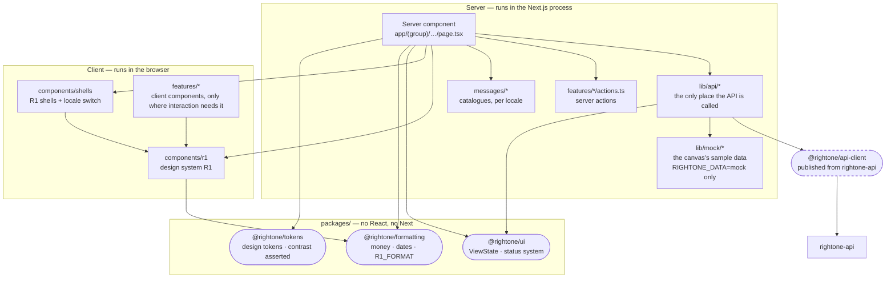

# Layers - what may import what, and where data enters

Where does a page get its data, which side of the server boundary is each piece on, and what may
never be imported where?



## Four rules about direction

**`lib/api/*` is the only place the API is called.** A component that fetches is a component that
cannot be tested without a network and cannot be moved without finding every call site. The seam
returns a `LoadOutcome` - data or a failure with a code - and never throws for a business refusal.

**The packages know nothing about React or Next.** `@rightone/ui` exports types and pure
functions; `@rightone/formatting` and `@rightone/tokens` are plain TypeScript. That is what lets the
rules that matter - the four states, the null-money rule, the contrast ratios - be proved by
`vitest` with no rendering. A package that imported React would put those proofs behind a renderer.

**Server by default; client only where interaction needs it.** Every page is a server component
until something has to respond to a keystroke. A token never reaches the browser as a consequence:
the session is read on the server, and `lib/api` is the only thing that holds it.

**`@rightone/formatting` has no competitors.** An inline `toLocaleString` anywhere else is a lint
failure (`R23.7`). The rule earns itself on three specific correctness questions that are otherwise
a matter of remembering: whether an unknown amount renders as `-` or `0`, which time zone a
timestamp is shown in, and what a percentage is a percentage *of*.

## Where the state boundaries are

| State | Lives | Why not elsewhere |
|---|---|---|
| Server data for a page | Fetched in the server component, passed down as props | A client cache would have to be invalidated by something, and nothing here is long-lived enough to earn one |
| Which of the four view states is showing | Derived from the `LoadOutcome`, not stored | Storing it lets a screen be in "empty" while holding data |
| Theme | CSS variables from `@rightone/tokens` | A JavaScript theme context means a flash of the wrong palette before hydration |
| Locale | The `r1-locale` cookie, read on the server before render; the shells' switch writes it and asks for a new render | Not client state: the catalogue is what makes an error code render correctly, and it is chosen before render |
| Anything a user typed | The form element, and the server action that reads it | This product has no long forms yet. The first one is the moment to record a decision, not before |

Deliberately absent: a global client store. Five surfaces sharing a session and a design system do
not need shared client state, and adding one before a screen demands it decides for every screen
that comes after.

## The design system's components, and the one boundary they add

`components/r1` is the design system R1 as TypeScript source, one component per file, converted once
from the design system's bundle on 15 October 2026 with its rendered output unchanged. Its format rules
are `R1_FORMAT` from `@rightone/formatting`, so a value reads the same in a component and on a server
page; a change of a format rule in the design system is ported there.

The module is a client module, which draws one line through every page: **a server component imports
R1's components, never its values.** A function or object exported from `components/r1` is a client
reference on the server, so a page formats with `R1_FORMAT`, and passes R1 data, never a callback.
Interaction a page cannot express as a link or a form lives in a small client component under
`features/`, and the language switch lives once in `components/shells`.

## The mock backend, and why it sits behind the seams

`RIGHTONE_DATA=mock` makes every seam answer from `lib/mock/backend` instead of returning
`SERVICE_NOT_CONFIGURED`. The mock backend behaves as the API will: RightOne ID's accounts sign in and start a
session, each family holds its records per session, seeded from the design canvas's data, and every command a
screen sends changes them, so the next screen reads what the act did. The seam answers in its own
`LoadOutcome`, so a page cannot tell the difference, and the code that walks the journeys now is the code
that will walk them against the API.

The session is the data access layer (`lib/api/session.ts`): every page of the premises portal and the
inspector's surfaces asks it first and sends a reader without the right session to sign in; a check in a
layout would not run again on a client-side navigation. `?view=` remains for design review only: it draws any
state a board drew, and a page given none reads the session's data. Without the variable nothing changes: the
seams fail loudly, nobody can sign in, and the `(dev)` pages answer 404.

## The seam that is not wired, and why it fails loudly

Outside mock mode, every seam in `lib/api` returns:

```
{ data: null, failure: { code: "SERVICE_NOT_CONFIGURED", retryable: true } }
```

Not an empty array. An empty array would tell a member of the public that no certificate matches
their reference - a claim about a business - when the truth is that this client is not wired up.
The distinction is the point of the four-state contract and it is worth having in the stub, because
the stub is what every seam since was copied from.

## Related

`view-state.md` for the contract that seam returns into · `surfaces.md` for who consumes it ·
`rightone-api/docs/architecture/repository-topology.md` for why `@rightone/api-client` is a
published package rather than a shared folder.
