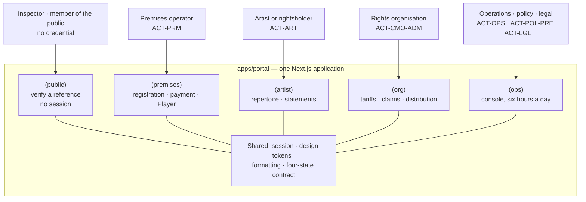

# Surfaces - five audiences, one application

Who uses which surface, with what authority, and why is this one deployment rather than five?

## The five, and what makes each one different

| Route group | Audience | Authority | The property that shapes it |
|---|---|---|---|
| `(public)` | Anyone with a reference | **None** | Discloses only what the approved profile permits, by reference. Used by inspectors in the field, so contrast and target size are functional requirements |
| `(premises)` | The venue operator | Person token, scoped to their premises | The user who pays and who holds a Player. Most likely to be on a phone, in a noisy room |
| `(artist)` | Rightsholder | Person token, scoped to their repertoire | Reads money. Every unknown amount must read as unknown, never as zero |
| `(org)` | Rights organisation staff | Person token, elevated | Administers tariffs, claims and distribution - the screens where a mistake moves money |
| `(ops)` | Operations, policy, legal | Person token, elevated, with separation of duties | Six hours a day in the same screens. Keyboard operation is the difference between usable and not |

## Why one application

The five share authentication, the design system and the formatting layer; route groups give each
its own layout. Five deployments would buy isolation nobody has asked for and cost a shared session.

That changes when one surface needs infrastructure isolation the others do not, and **there is
exactly one such case, coming from outside this repository**: `BR-SVC-11` requires the public
verification route to remain available independently of the rest of the service. So `(public)` is
the first split candidate and it is not a preference - it is a mandatory requirement the Ministry
has already approved (`DEC-14`).

It is not split yet because the route has nothing to call: `lib/api/verification.ts` is a seam that
returns a failure. The decision to record before it is built is whether `(public)` becomes its own
deployment here or is served by the independent verification service designed in
`rightone-api/docs/architecture/request-path.md`. **The second is the better answer** - a static
page against a read replica has fewer moving parts than a Next.js deployment - and it means this
repository eventually loses `(public)` rather than splitting it.

## What every surface owes the user, regardless of audience

**A failure never renders as an empty result.** Telling a premises it has no evidence when the
evidence service is down is a claim about their business rather than an admission about ours. This
is the whole reason the four-state contract exists - see `view-state.md`.

**An unknown amount renders as `-`, never `0`.** On a finance screen, blank reads as zero, and zero
and unknown are different facts.

**Messages come from error codes**, never from parsing a `detail` string, so the same failure reads
correctly in both locales and a server-side wording change is not a breaking change here.

## What is built

The shell, the rules and the packages: design tokens with every documented contrast ratio asserted
in a test, the formatting layer, the four-state contract, the status system, and the design system R1
as React components (`apps/portal/components/r1`, generated from the design system's own bundle).

On top of them, the screens of the first journeys: the premises journey (public pages, registration,
payment, status records) and the inspector's journey (the field client and the inspection console),
33 screens in the order of the screen list in `rightone-platform/pm`. **No surface can load real
data**, because the contract is not published. Every seam returns `SERVICE_NOT_CONFIGURED`, except
when the portal runs with `RIGHTONE_DATA=mock`: then it answers with the design canvas's sample data,
and every page says so at its foot.

Of the five, only `(public)` has an endpoint in the contract at all. The other four are waiting on
API surface that has not been scheduled against them, which is the third Medium finding in the
architecture review: four surfaces waiting on a contract nobody has sequenced is how a front-end
team spends a quarter on scaffolding.

## Three route groups that are not surfaces

Three groups sit beside the five. None of them is a sixth audience.

| Route group | What it holds | Why it is here, and until when |
|---|---|---|
| `(id)` | Sign in, register, confirm the email, choose an organisation, sign out | Stand-ins for RightOne ID (`id.rightone.vn`), signing in against the mock backend's accounts so the portal is walked from the first click. Identity is another service's pages; these go when the portal signs in through it |
| `(inspector)` | The field client on the inspector's phone (`/field`) and the inspection console on the desk (`/inspection`) | The authority's staff, with a person token scoped to their authority. Whether this stays in the portal or moves to the operations console is open; the field client's offline behaviour is the deciding constraint |
| `(dev)` | `/design-system` (every R1 component) | For the people building and reviewing the product. Answers 404 unless the portal runs on mock data |
