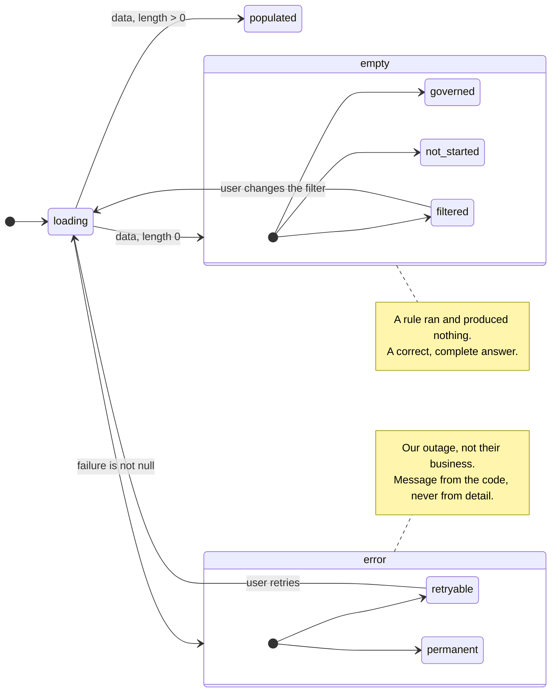

# View state - the four states, and the one branch that must not exist

What may a view that loads data render, and what may it never render?



## The branch that must not exist

```
data ?? []    →    "No results"
```

That is the tempting shape and it is the defect this whole contract exists to prevent. It tells a
premises operator that they have **no accepted evidence for the period** when the truth is that the
evidence service is down. One of those is a governed answer about their business; the other is our
outage. Rendering them through the same branch makes the product lie in the user's favour and then
against it.

So `toViewState` refuses the ambiguity structurally: it checks `failure` **first**, and only then
asks whether the data is empty. A failure can never reach the empty branch because the empty branch
is not reachable while a failure is present.

## Why empty has three kinds

`ViewState` makes the caller name which empty it is, because in this product "no data" is usually a
governed outcome rather than a gap:

| Kind | Means | What the user can do |
|---|---|---|
| `governed` | A rule ran and produced nothing. No payable obligation. No accepted evidence yet for this period. No measurement available | Nothing - and that is the answer. The screen must say *why*, because "no results" here reads as a fault |
| `not-started` | Nothing has happened yet in this period | Wait, or start the thing |
| `filtered` | A filter excluded everything | Change the filter. The only one of the three that is the user's to fix |

`explanation` is required, not optional. "No results" alone is a dead end on every screen in this
product.

## What the error state carries, and what it does not

It carries the **stable code** from `contracts/errors/error-codes.yaml`, a trace id for support,
and whether retrying is worthwhile. It does not carry a message: the message is rendered from the
code, per locale, in `lib/errors/messages` (`R23.8`).

Two things that buys. A wording change on the server is not a breaking change here. And the same
failure reads correctly in Vietnamese and English without the server knowing which one the user
chose.

`retryable` is worth its own field rather than being inferred from the code: it spares a pointless
retry on a permanent refusal, and prompts a useful one on a transient failure. Both are guesses when
the client has to infer them from a status class.

## What is enforced, and how

- **Four states or the pull request does not merge** (`R23.4`). Every view that loads data
  implements all four.
- **`toViewState` is the only way to build a `ViewState` from a load result**, so the
  failure-before-empty order is written once rather than remembered per screen.
- **`packages/ui` has no React import**, so all of this is proved by `vitest` with no renderer -
  which is what makes the proof cheap enough to keep.

## Related

`layers.md` for where `LoadOutcome` comes from · `surfaces.md` for the audiences this protects ·
`rightone-api/contracts/errors/error-codes.yaml` for the codes, which are the contract.
